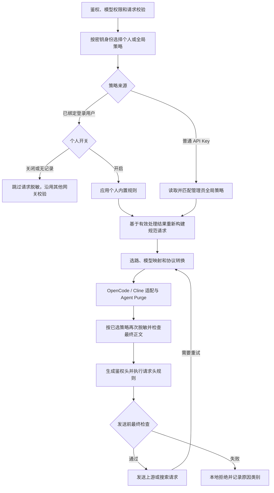

# 请求脱敏设计

状态：首期实验性实现，默认关闭。已接入 HTTP、Responses WebSocket、搜索出口与个人控制台，并通过自动化回归测试；尚未完成全部目标设计验收，启用前应核对下述覆盖边界。设计及实现日期：2026-11-25。

## 当前实现与验收边界

- 已实现个人／全局策略隔离、修订冲突检查、四协议文本检查、渠道追加规则、请求头凭据复制拦截、逐轮 WebSocket 检查与策略变化重连提示、三种搜索服务查询检查。
- Audio／Realtime／WebRTC 在文本覆盖下明确标记未检查，严格覆盖下本地拒绝；Embeddings／compact 严格覆盖下也拒绝。
- 执行模式失败诊断不持久化请求正文、请求头、上游错误正文或原始错误摘要，即使管理员启用完整原文也不例外；原因是文本模式允许未检查字段，不能把它们写盘后宣称已脱敏。失败摘要仍保留错误分类、上游 HTTP 状态以及通过类型识别的安全诊断（取消、写回失败、超时、DNS、连接拒绝/重置、EOF、工具数量限制等），不直接写入任意原始错误字符串。正文省略原因通过 `content_omitted_reason` 单独记录和展示，不再覆盖失败摘要；旧记录已丢弃的具体错误无法恢复。
- 原文不写入新脱敏回执；回执只含策略来源、修订、类别计数与覆盖状态。入口本地拒绝也记录回执，不计模型费用。
- 本次发布检查已通过全量 `go test ./... -count=1`、`go vet ./...`、前端 23 项回归测试与程序构建；同时补充带显式思考参数的模型范围匹配和计费模型归一化回归。当前环境 `CGO_ENABLED=0`，未运行 race 测试。
- 仍需验收：控制台真实浏览器交互与布局、性能基准及热路径快照缓存、完整未知字段／新增协议字段清单、试运行的选渠道最终报文模拟、审计回执大小边界与完整端到端安全审查。
- 本文后续章节是目标设计，不代表全部项目已经实现。

本方案以 APISHARE 当前提交 `c938b5013396` 为基础。目标是在发送给模型服务和搜索服务之前，按登录用户的个人选择或普通 API Key 的管理员策略替换个人信息、密钥等敏感文本，并提供试运行和不含原文的处理记录。

2026-11-25 补充：登录用户在个人控制台独立开启／关闭请求脱敏，不受管理员全局脱敏配置影响。个人配置与全局配置分别解析、保存和生效，具体优先级见第 3 节。

## 1. 参考实现与现有基础

### new-api 的参考范围

调研固定到 `QuantumNous/new-api@6627f0e3f37c002564b630a73e5afb0d28a92d3b`，该提交时间为 2026-11-24 10:31:03 UTC。以下描述仅对应这一快照。

- [请求脱敏插件](https://github.com/QuantumNous/new-api/blob/6627f0e3f37c002564b630a73e5afb0d28a92d3b/plugins/tasks/request-redact/plugin.js)：提供邮箱、电话、身份证、银行卡、API Key／令牌、IPv4 六类内置检测，以及自定义正则和替换文本。
- 入口阶段替换已识别的文本字段；出口阶段检查后续处理是否再次引入敏感内容，默认拒绝仍命中的请求。
- 身份证和银行卡带校验位检查，减少把普通长数字当作证件的情况；代码也包含附件处理与可选的回复遮盖。
- [请求处理配置](https://github.com/QuantumNous/new-api/blob/6627f0e3f37c002564b630a73e5afb0d28a92d3b/setting/request_plugin_setting/config.go)支持全局处理实例与渠道绑定。
- [处理记录结构](https://github.com/QuantumNous/new-api/blob/6627f0e3f37c002564b630a73e5afb0d28a92d3b/relay/common/request_plugin.go)区分管理员审计和用户记录，限制记录大小，不保存命中的原始文本。
- [试运行接口](https://github.com/QuantumNous/new-api/blob/6627f0e3f37c002564b630a73e5afb0d28a92d3b/controller/request_plugin.go)允许使用样例检查处理效果。

APISHARE 借鉴这些产品行为，采用 Go 原生实现。第一期不增加脚本运行时和插件市场；规则、协议文本提取器与校验器独立编写。若后续直接引入第三方源码，需另外核对对应文件的许可和分发要求。

### APISHARE 当前的接入点

| 已有能力 | 当前代码位置 | 对设计的影响 |
| --- | --- | --- |
| 四协议 HTTP 转发、原生透传、跨协议转换和故障重试 | `cmd/apishare/proxy.go` | 原生和转换路径都必须执行脱敏；故障切换不能拿回原文 |
| Agent Purge、OpenCode Free、Cline 等请求改写 | `cmd/apishare/proxy.go`、`opencode_retries.go` | 脱敏必须覆盖这些改写之后的最终正文及内部重试 |
| 独立的 Responses WebSocket 转发 | `cmd/apishare/responses_websocket.go` | 每个带输入的事件都要检查，不能只处理握手 |
| Brave／Tavily／Exa 网页搜索回退 | `cmd/apishare/responses_web_search.go` | 搜索查询也是独立的数据出口 |
| 请求头覆盖、通配透传和变量引用 | `cmd/apishare/headers.go` | 正文脱敏之外，要避免自定义头重新携带敏感信息 |
| 失败诊断脱敏和“完整原文”模式 | `failure_log.go`、`failure_log_redaction.go` | 当前日志脱敏不改变实际转发内容；完整原文会保留正文和凭据，需增加策略约束 |
| SQLite settings、修订号控制、既有处理回执 | `store.go`、`agent_purge.go`、`billing_usage.go` | 可沿用配置和回执模式，无需新建通用任务平台 |

## 2. 产品行为

管理员后台增加独立的「请求处理」页面，首项为「请求脱敏」，用于管理普通 API Key 的全局策略。登录用户在个人控制台增加「请求脱敏」卡片，可独立开启／关闭，并查看生效范围与本人的处理结果。

### 管理员全局策略的工作模式

| 模式 | 正文是否变化 | 是否因命中而拒绝 | 页面文案 |
| --- | --- | --- | --- |
| 关闭，初始状态 | 否 | 否 | 未启用请求脱敏 |
| 仅观察 | 否 | 否 | 仅检测并记录数量，原文仍会发送 |
| 执行脱敏 | 是 | 最终仍命中、处理失败或超限时拒绝 | 发送前替换敏感文本 |

启用执行模式后，最终检查固定开启。规则处理失败不能自动回退成原文透传。策略所有者如需关闭，应显式保存自己的设置，而不是依赖运行错误降级。

### 登录用户的个人开关

- 个人控制台提供「启用我的请求脱敏」开关。未保存配置时默认关闭；只有「开启／关闭」两种状态，没有「跟随全局」状态。
- 开启后使用程序内置的个人脱敏配置，执行模式为 `enforce`、覆盖等级为 `text`，对该身份绑定密钥发出的所有受支持模型请求生效，不区分客户端。
- 个人配置预选 API Key／令牌、邮箱、手机号、身份证、银行卡，使用类型占位符，工具参数命中则拒绝；不继承管理员的模式、范围、自定义规则、严格覆盖等级或渠道追加规则。
- 管理员全局关闭或设为仅观察时，用户仍可开启执行脱敏；管理员全局开启时，用户关闭后也不执行本项脱敏。
- 第一阶段个人页面只提供开关、内置规则只读说明和试运行，不增加个人正则编辑器。开关按 XAuth 身份保存，密钥轮换、退出控制台或更换客户端不会重置。

### 推荐初始配置

- 管理员全局规则预选：API Key／令牌、邮箱、手机号、身份证、银行卡。IPv4 初始不选，避免影响排查网络和编程任务。
- 不自动识别人名、公司名、自由文本地址；这些需要管理员提供明确规则，或后续引入专门的识别能力。
- 使用类型占位符：`[API_KEY]`、`[EMAIL]`、`[PHONE]`、`[ID_CARD]`、`[BANK_CARD]`、`[IPV4]`。
- 普通 API Key 使用管理员全局策略；XAuth 身份绑定的密钥使用独立的个人开关与内置规则配置。不依赖客户端或 User-Agent。
- 不在第一期提供原文还原。模型回复中保留占位符，也不把敏感值映射表发送给上游。
- 对命中策略且处于执行模式的请求，诊断文件只能保存处理后的内容。

同一个邮箱多次出现时使用相同类型占位符即可。保留“人物 A／人物 B”区分的编号占位符属于后续能力，需要同时解决多轮会话映射和内存生命周期问题。

## 3. 生效范围与优先级

请求鉴权后，先根据 API Key 在数据库中的真实身份绑定选择策略来源；一次请求只选择一种来源，不合并全局与个人脱敏规则。

| 请求身份 | 个人开关 | 管理员全局配置 | 实际行为 |
| --- | --- | --- | --- |
| XAuth 用户绑定密钥 | 开启 | 关闭 | 按个人内置配置执行脱敏 |
| XAuth 用户绑定密钥 | 开启 | 仅观察或执行脱敏，任意范围与规则 | 按个人内置配置执行脱敏 |
| XAuth 用户绑定密钥 | 关闭 | 任意 | 关闭本项脱敏，不执行全局观察或渠道追加规则 |
| XAuth 用户绑定密钥 | 尚未保存 | 任意 | 默认关闭，可在个人控制台开启 |
| 未绑定 XAuth 身份的普通 API Key | 不适用 | 任意 | 按全局策略的模式、范围和规则处理 |

解析逻辑：

```text
鉴权取得 API Key
  → 查询可信的 XAuth 身份绑定
  → 存在绑定：读取该身份个人配置 → 开启则使用内置个人规则，关闭则停止本项处理
  → 无绑定：读取管理员全局策略 → 按范围、模式及渠道追加规则处理
```

“登录用户请求”指使用其身份绑定密钥的调用，不要求 SDK／CLI 请求同时携带浏览器登录 Cookie。控制台退出只结束管理会话，不改变该密钥所属身份；把一个普通密钥输入客户端，也不会因为浏览器另有登录就变成个人策略。

1. 个人策略默认覆盖该身份绑定密钥有权使用的全部模型；管理员全局的密钥／模型范围不参与筛选。
2. 全局策略只覆盖普通 API Key，按 Key ID 和客户端请求的模型 ID 匹配；两个维度同时填写时取交集。绑定用户的 Key 即使被写入全局范围，也不会覆盖个人选择。
3. 模型名称沿用权限校验时的客户端模型名称，保留请求名称和解析后基础模型供说明，不用映射后的上游名称扩大权限。
4. 渠道追加规则只属于全局策略分支，不向个人分支叠加；全局分支内不能通过渠道配置恢复已替换内容。
5. 故障重试、同渠道换 Key、协议转换与第三方搜索沿用进入时解析好的策略来源。个人策略关闭时，不能在搜索或重试路径再次加载全局策略。
6. 全局策略中的附加搜索规则只约束全局分支；个人分支在搜索出口使用相同的内置个人规则。
7. 用户只能通过经过登录鉴权的个人设置 API 改变开关。入站正文、请求头、伪造的用户 ID 或未认证的 `enabled` 参数不能改变策略来源。

身份或个人配置读取失败应返回明确错误，不能误判成“普通 Key”或“用户已关闭”。用户记录不存在才使用默认关闭；个人已明确关闭时，无需加载或编译全局规则，也不受全局配置损坏影响。

独立选择仅针对本项请求脱敏；模型权限、配额、限流、渠道可用性和 Agent Purge 的授权规则继续按现有机制校验。

## 4. 检查哪些内容

### 文本和结构边界

使用按协议识别字段的提取器，不对整个 JSON 字符串执行替换，也不对所有字符串值做无差别改写。

下表的默认动作针对执行模式。仅观察模式只收集检测结果和覆盖状态，不改写、不因命中或覆盖不完整而拒绝。

| 内容 | 默认动作 | 说明 |
| --- | --- | --- |
| Chat `messages[*].content`，含 system／developer | 检测并替换 | 包含历史消息与普通文本块 |
| Responses `instructions`、字符串 `input`、输入消息文本 | 检测并替换 | 同时覆盖 WebSocket 的 create／append 输入 |
| Anthropic `system`、消息文本、嵌套工具结果文本 | 检测并替换 | 保留内容块形状与缓存标记 |
| Gemini `systemInstruction`、`contents[*].parts[*].text` | 检测并替换 | 普通文本与带签名的思考内容必须分开 |
| 工具返回文本、Responses `function_call_output.output` | 检测并替换 | 已解析的 JSON 工具结果按字符串叶子处理，保留非字符串值 |
| 工具描述和参数说明中的自然语言 | 检测并替换 | 不改属性名、enum、const、类型、必填列表及执行约束 |
| 函数调用参数 | 检测，命中则拒绝 | 默认不自动改写路径、命令、收件人等执行参数；可后续增加显式的参数改写模式 |
| `user` 和已知 metadata 文本值 | 按字段规则检测 | 内部会话信息先提取；保留协议必需的关联字段，覆盖边界需在预览中说明 |
| 模型名、角色、工具名、call ID、response ID、数字和布尔参数 | 保留结构 | 不属于自然语言脱敏范围，不宣称对这些标识符匿名化 |
| thinking 签名、加密推理内容、Gemini thought／签名块 | 不改写，标记未检查 | 修改签名对应的正文同样可能破坏校验 |
| 图片、音频、PDF、DOCX、文件 ID、缓存上下文 | 不解码正文，标记未检查 | 第一期不做 OCR、文件下载和文档重写 |
| 外部 URL、文件名、协议之外的自定义字段 | 标记覆盖边界 | 第一期不自动更改下载地址、路径或未知字段；严格模式下拒绝无法确认的内容 |

工具参数中的字符串 JSON 应先解码再检测，防止转义隐藏敏感值；需要检查但无法解析的结构返回明确错误。工具 schema 中不宜修改的常量若被策略认定包含敏感值，同样拒绝，不用错误占位符破坏 schema。

对于新协议字段，应先登记为已检查、结构字段或未检查内容，再允许严格模式放行。文本提取器需要维护明确的字段清单。

### 覆盖等级

- **文本模式，默认**：保护上述可检查文本；允许附件和不透明状态通过，同时在记录中显示「含未检查内容」。不能将这种请求显示为“全部内容已脱敏”。
- **严格模式**：存在不可检查的附件、签名内容、远端历史、未知承载内容的字段或不支持的接口时，拒绝该请求。结构性模型／工具标识符仍按公开的字段边界保留。

正则检测本身也可能漏报。这里的“已检查”仅表示已执行配置中的规则，不表示证明内容不含所有个人信息。

### 协议覆盖

| 路径 | 第一期行为 |
| --- | --- |
| OpenAI Chat、Responses、Anthropic Messages、Gemini，含原生／转换／SSE | 完整接入文本处理和最终出口检查 |
| Responses WebSocket | 每个带输入的事件独立处理；取消和中断事件不改写 |
| Brave／Tavily／Exa 搜索回退 | 查询进入搜索 SDK／HTTP 请求之前执行同一套规则 |
| Embeddings、Responses compact、Audio、Realtime／WebRTC 等其他接口 | 文本模式明确标为未覆盖；严格模式在转发前拒绝，不能静默绕过 |

不修改 SSE 回复，避免把请求脱敏扩展为另一套输出流处理系统。可选的回复遮盖放到后续版本单独设计。

## 5. 请求处理顺序



### 入口处理

- 策略快照包含 `policy_source`、对应修订号和规则版本。先解析身份与个人开关，再决定是否读取全局设置，不能写成 `global.enabled && user.enabled`。
- 个人关闭时跳过本项文本检查、改写和最终脱敏拒绝；原有协议校验、鉴权及日志保存机制照常运行。个人开启时，采用完整的个人执行流程。
- 在进入路由重试之前完成基础策略处理。随后从处理后的正文重新生成 `task.canon`，让 `task.body` 与规范请求保持一致。
- 内部会话亲和、API Key 身份、模型权限使用鉴权后提取的独立状态，不依靠脱敏后的某个字符串重新识别用户。内部原始会话标识不写入新的脱敏审计记录。
- OpenCode 环境提取的 `EnvironmentSource.Body`、搜索回退的 `task.body`、故障重试起点均使用处理后的正文。
- 原始正文仅在入口校验所需的局部内存中短暂存在，不传给执行模式下的失败诊断，也不新增永久原文副本。

### 每次出站处理

- 从入口处理后的基础请求构造每次尝试。模板注入和兼容处理产生的文本也要经过当前策略的出站脱敏；渠道追加规则仅在全局分支执行。
- 在兼容处理完成后检查最终正文。检查发现漏网内容时拒绝，不能再次悄悄换用未处理的请求。
- 在实际发送边界检查请求头，避免 `*` 透传和 `{client_header:...}` 把敏感值重新带出。
- 请求内容封装为已检查的发送对象，包含正文、策略修订号和阶段回执；只要后续代码替换正文，就需要重新取得检查结果。不能只在 `doRelay` 的第一次调用里打一个已处理标志。
- 本地脱敏拒绝不是上游失败，不消耗网络重试预算，不触发渠道冷却，不切换到无策略的出口。必须新增可识别错误类型，在重试循环和 `finalizeCall` 中显式处理。
- `retryOpenCodeReasoning` 会生成新正文，必须重新经过发送检查；`retryClineUnauthorized` 只更新厂商鉴权时仍应确认正文沿用已检查版本。重定向也不能把有身份信息的正文或凭据转发到未授权地址。

### 请求头策略

正文里的密钥需要替换，上游调用必需的 Authorization／x-api-key 则应使用管理员配置的渠道凭据。两者分开处理。

- 不对服务器生成的厂商鉴权头做通用密钥替换，否则会破坏正常调用；这些值永远不进入处理回执和诊断原文。
- Cookie、来源 IP、浏览器身份及自定义客户端头由明确的头策略约束；即使渠道配置了宽泛透传，也不能跳过基础策略。
- 协议必需的版本、beta、内容类型保留。客户端文本头命中敏感规则时，可安全删除的头删除，无法安全改写的必需头则拒绝。
- 会话关联头不做随机改写；第一期将其列为保留的协议标识，并在覆盖说明中明确，不能宣称请求身份已匿名化。后续若需要匿名身份，应另设计稳定映射。
- 执行模式下，鉴权头不能通过 `{client_header:Authorization}` 等变量重新取回客户端凭据。发现这种渠道配置时，在保存或试运行阶段明确提示冲突，并在实际发送阶段阻止绕过。

### WebSocket 和远端历史

- `response.create`、`response.append` 每轮重新解析同一密钥身份对应的个人开关或全局策略，提取内容后处理；`response.cancel`、`response.interrupt` 保留既有归属校验。个人开关变化在下一轮生效，不能被全局缓存覆盖。
- WebSocket 的头只在握手时发送。若个人开关切换或其他策略变化要求不同的握手头，下一轮要求重连；规则变化影响旧历史时同样提示重新建立上下文，不能声称旧连接已经符合新策略。
- HTTP 的 `previous_response_id`、conversation、Gemini cachedContent 等远端历史不在当前正文中。严格模式拒绝无法验证的远端上下文；文本模式标记仅检查本次提交内容。
- 已发送到上游的历史不能撤回。重新连接也不能消除远端已有历史，严格模式应要求新的、可检查的上下文。
- 每个事件独立记录处理状态；本地拒绝的轮次不生成模型费用，也不关闭仍可继续使用的连接，除非当前策略要求重连。

### 第三方搜索

`relayResponsesSearchFallback` 在调用 `searchWeb` 前检查最终 query。Brave 的 URL 查询参数和 Tavily／Exa 的 JSON 查询都只能使用处理后的值。

响应中的 `web_search_call.action.query` 也使用处理后的值，避免网关在合成结果时重新带回原始查询。搜索出口处理失败时不调用搜索服务。

### 计费与预算

- 上游提供真实 usage 时继续使用真实值；缺少输入 usage 时，按最终实际发送的正文估算，不能继续按脱敏前的 `task.canon` 估算。
- 将当前 `agentPurgeBody` 的用途整理为通用的最终出站正文／输入估算状态，同时保留 Agent Purge 的独立回执。
- 脱敏或模板注入后重新验证上下文与输出预算；替换文本变长也要考虑。
- WebSocket 增量请求沿用现有不从局部历史推断全量输入用量的行为。

## 6. 检测与替换引擎

核心放在 `internal/requestredact/`，不依赖 Gin、数据库或网络。网关适配层负责策略匹配、错误响应和回执持久化。

### 内置识别

- 先提取候选，再校验格式和上下文。身份证检查日期与校验位；银行卡检查长度与校验位；API Key 优先识别明确的厂商前缀和令牌上下文。
- API Key、邮箱、身份证、银行卡、电话、IPv4 使用确定的重叠优先级。先识别整段邮箱，避免将邮箱本地部分中的手机号替换后留下域名。
- 电话区分大陆手机号与带国际区号号码；普通订单号、毫秒时间戳、模型版本、代码符号需要负样例验证。
- IPv4 先做地址解析并排除明显的版本号形状；是否覆盖私网地址由该规则选项明确控制。不能把“未选 IPv4”写成“IP 已脱敏”。
- 识别覆盖范围和误报条件随规则版本记录，不能只记录后台配置修订号。

### 自定义规则

- 使用 Go `regexp` 支持的语法。表单和试运行均由后端校验，不使用浏览器 JavaScript 正则作为生效依据。
- 最多 50 条，每条表达式最多 1024 字节，替换文本最多 64 个字符；不接受空匹配规则和重复规则 ID。
- 替换内容按字面量处理，不开放 `$1` 等捕获组回填，避免把原值重新拼回结果。第一期不开放随意 JSON patch。
- 内置规则与自定义规则先在原始字段上生成匹配区间，再处理重叠并一次替换；不对前一条规则生成的占位符继续层层替换。
- 最终检查扫描最终文本。若管理员的自定义替换文本也命中规则，试运行提示并阻止发布有冲突的配置；运行中发现未预期冲突时拒绝请求。
- JSON 解码后匹配，避免 Unicode 转义绕过。未修改部分尽量保持原始表示，保留未知字段和整数精度；有歧义的重复 JSON 键应统一拒绝，避免不同解析器选取不同值。

### 资源限制

建议初始限制为文本总量 4 MiB、嵌套深度 64、节点数 100000、单请求匹配数 4096。限制应经过真实请求基准后调整，且不能通过截断扫描再放行剩余内容。

执行模式超过检查预算时拒绝；观察模式记录“未检查完成”，仍按观察语义处理。没有命中的请求返回原始正文，不做无意义的 JSON 重编码。配置发布时预编译规则，热路径使用不可变快照。

关闭或不匹配策略时直接走现有路径，不增加正文解码。启用时复用解析结果；已检查对象的正文和策略版本均未变化时，可复用结果。对后续改写则必须重新检查，不能仅因某次尝试已经检查而跳过。

性能验收按 4 KiB、64 KiB、512 KiB、4 MiB 请求分别测量，覆盖命中／无命中、五类默认规则／50 条自定义规则。先取得基准，再制定延迟指标，不预先承诺固定毫秒数。

## 7. 配置与管理 API

在 SQLite `settings` 中新增 `request_redaction_policy`，整体保存一份有 schema 版本的 JSON；第一期无需新增规则表。

以下为普通 API Key 使用的管理员全局配置示例，仅说明字段语义，不作为登录用户的配置来源：

```json
{
  "schema_version": 1,
  "revision": 12,
  "rules_version": "builtin-v1",
  "mode": "enforce",
  "coverage": "text",
  "scope": {
    "key_ids": [],
    "models": []
  },
  "categories": ["api_key", "email", "phone", "id_card", "bank_card"],
  "replacements": {
    "api_key": "[API_KEY]",
    "email": "[EMAIL]",
    "phone": "[PHONE]",
    "id_card": "[ID_CARD]",
    "bank_card": "[BANK_CARD]"
  },
  "tool_arguments": "reject_on_match",
  "headers": {
    "strip_forwarding_identity": true,
    "scan_custom_text": true
  },
  "rules": [
    {"id": "employee-id", "pattern": "EMP-[0-9]{6}", "replacement": "[EMPLOYEE_ID]"}
  ],
  "channel_overlays": []
}
```

空 key／model 列表表示该维度全部匹配。`revision` 由服务器分配；保存时比较旧修订号，编译和校验全部通过后再提交配置。持久化成功才切换运行快照，保存失败保留原策略。

`headers.strip_forwarding_identity` 在最终头集合中移除 Cookie、Forwarded、X-Forwarded-For、X-Real-IP 等来源身份头，即使它们由渠道透传规则重新加入。`scan_custom_text` 检查非鉴权、非协议保留头中的文本。第一期两项在执行模式下默认开启，不把它们表述为协议标识匿名化。

HTTP 请求全程沿用进入时的快照；WebSocket 按轮次刷新。已配置执行模式却无法加载有效规则时，匹配范围内的请求必须拒绝，不能把配置错误等同于“未开启”。全局配置损坏只影响全局分支；无法确定全局范围时，保守拒绝普通 Key 的模型出口并提示管理员修复，不影响已解析个人配置的请求。

### 个人设置持久化

新增 `user_request_redaction_configs` 用户偏好表，不新增个人规则表：

```sql
CREATE TABLE IF NOT EXISTS user_request_redaction_configs (
  sub TEXT PRIMARY KEY,
  enabled INTEGER NOT NULL DEFAULT 0 CHECK (enabled IN (0, 1)),
  revision INTEGER NOT NULL DEFAULT 0,
  updated_at TEXT NOT NULL DEFAULT CURRENT_TIMESTAMP
);
```

- `sub` 使用服务端认证得到的 XAuth 身份，与当前用户映射采用同一身份空间；不能从请求 JSON 接收待修改的用户 ID。
- 无记录返回 `enabled: false`、`revision: 0`。使用条件更新或事务比较个人修订号，每次成功保存只递增个人修订号；不校验管理员修订号。
- 普通密钥轮换不改变 `sub`，因此保持原开关；注销控制台同样保留。删除用户时按既有身份清理规则处理，不因 Key 重建套用全局配置。
- 个人内置规则作为编译资源按 `rules_version` 管理，不从全局 settings 取值；第一期不开个人规则编辑入口。
- 缓存至少区分策略来源、用户身份、个人修订号与规则版本。全局策略更新不改变个人配置，不让其他用户命中同一配置缓存。
- 开启时校验个人内置规则可用；关闭只需合法会话与正确个人修订号，不能因为全局规则或内置规则编译错误而无法保存关闭。

### 管理与个人 API

| API | 用途 |
| --- | --- |
| `GET /{admin_path}/api/request-processing/redaction` | 读取模式、范围、规则、覆盖说明和修订号 |
| `PUT /{admin_path}/api/request-processing/redaction` | 校验并保存完整策略，旧修订号返回 409 |
| `GET /{admin_path}/api/request-processing/redaction/catalog` | 读取内置类别、规则版本、样例和协议支持范围 |
| `POST /{admin_path}/api/request-processing/redaction/dry-run` | 使用已保存或草稿规则处理样例，不请求外部服务 |
| `GET /api/user/request-processing` | 返回个人 `enabled`、个人 `revision`、实际模式、内置规则版本、只读类别和覆盖提示；不依赖全局开关 |
| `PUT /api/user/request-processing/redaction` | 保存当前用户自己的 `{enabled, revision}`；冲突只比较个人修订号，返回最新个人视图 |
| `POST /api/user/request-processing/redaction/dry-run` | 使用个人内置配置处理样例；不读取管理员规则，不调用外部服务 |

个人接口注册在现有 XAuth `userAPI` 鉴权组，写接口沿用 `X-APIShare-Request: user-console` 和现有来源校验。请求来源身份固定为当前登录用户，只读 API Key 查看会话或仅持有模型调用 Key 不具有修改个人设置的权限。

个人保存示例：

```json
{"enabled": true, "revision": 3}
```

客户端只提交开关与个人修订号；未知的用户 ID、全局策略字段、渠道 ID 或自定义规则字段拒绝接收。保存成功后 HTTP 新请求生效；已经执行的请求继续使用原快照，WebSocket 在下一轮刷新。

管理员试运行可使用 `key_id` 解析真实策略来源：绑定用户的 Key 预览个人实际策略；预览全局草稿则明确选择“模拟普通 Key”，不能将它显示为该用户的真实生效结果。个人试运行只接收样例格式和正文，固定使用自己的内置配置；关闭时可预览“开启后效果”，结果必须注明这是预览且不会保存开关。

管理员试运行支持 `format`、`body`、可选的 `key_id` 与 `upstream_id`，模拟同一套入口／出站引擎；涉及上游配置时只读本地配置，不发起真实模型或搜索请求。

试运行返回处理后的正文、分类计数、归一化字段位置、未检查内容、拒绝原因和耗时。输入样例只留在当前页面与请求内存，不写数据库、失败诊断、localStorage 或分析事件。接口限制正文大小并返回 `Cache-Control: no-store`。

第一期明确标注“试运行不执行外部服务，也不模拟外部服务二次加工”。若某种专用渠道无法在本地完整构造，返回未模拟的步骤，不把有限预览标成最终网络报文。

## 8. 后台与个人控制台

沿用当前 `console.css` 的浅灰背景、白色卡片、橙色操作色及现有表单组件；不引入新的前端框架。

页面布局：

```text
请求处理 / 请求脱敏                           [保存并生效]
发送前替换请求文本中的个人信息和密钥

[工作模式：关闭 / 仅观察 / 执行脱敏] [覆盖等级：文本 / 严格]
当前策略：全部普通密钥 · 全部模型 · 修订 12
登录用户使用独立个人开关，不受本页全局策略影响

[脱敏规则]             [生效范围]             [试运行]

内置类型
☑ API Key  ☑ 邮箱  ☑ 手机号  ☑ 身份证  ☑ 银行卡  ☐ IPv4

自定义规则
规则 ID        匹配表达式        替换文本              操作
employee-id    EMP-[0-9]{6}      [EMPLOYEE_ID]         编辑 / 删除

试运行
[协议] [密钥范围，可选] [渠道，可选]
[输入样例]                       [处理结果，只读]
结果：替换 3 处 · 邮箱 2 · 手机号 1 · 含 1 项未检查内容
```

- 页面首屏直接显示当前模式及生效范围；“仅观察”的说明始终可见，避免误以为已经阻止原文发送。
- 常规配置使用复选框与表格，JSON 配置放在高级展开区。类别勾选后展示对应替换文本和一个合成样例。
- 草稿变化后显示未保存状态；试运行明确指出使用草稿还是线上规则。切换到执行模式前提供一键加载合成样例，不强制用户提交真实敏感数据。
- 正则错误定位到对应规则，字段旁显示错误，并提供可聚焦的错误汇总；409 冲突保留草稿并提示重新加载比较。
- 桌面左右对照，窄屏上下排列；键盘可操作，处理结果通过状态区域播报。表格内容和错误信息不只靠颜色区别。
- 全局设置页的密钥选择器只列普通 Key；历史配置中出现绑定用户的 Key 时标明“不适用，使用个人设置”，不允许把它伪装成全局强制覆盖范围。
- 个人控制台显示“我的请求脱敏：已开启／已关闭”，开关始终可操作，不根据全局 `enabled` 禁用或隐藏。说明写明“独立设置，开启后使用内置规则，关闭后不执行本项脱敏”。
- 个人卡片提供独立的保存按钮、保存中／成功／失败状态、内置类别只读说明、覆盖提示和试运行。保存失败保持草稿并显示当前服务端实际状态，不在响应成功前显示已生效。
- 个人开关下方说明适用于本人密钥发起的所有客户端和有权限的模型，不要求另外勾选渠道；提示修改对新请求生效，现有 WebSocket 必要时需重连。
- 关闭的提示区分“停止后续请求脱敏”和“已发送的历史仍保留处理结果”；不能承诺关闭后能恢复已替换内容。图片／附件等仍按覆盖说明展示。
- 调用记录使用“已替换 3 处”“已检查，无命中”“仅观察，发现 3 处”“含未检查内容”“发送前已拒绝”等准确状态。

个人卡片示意：

```text
请求脱敏                                      [已开启]
[开关] 启用我的请求脱敏
独立设置，不受管理员全局脱敏配置影响。

内置规则：密钥、邮箱、手机号、身份证、银行卡
适用范围：本人密钥的所有客户端与有权限模型
覆盖说明：检查支持的请求文本，附件等内容可能未检查

[试运行]                                    [保存个人设置]
```

## 9. 处理记录与诊断文件

第一期沿用现有处理回执的存储方式，在 `billingDetails` 中增加可选 `request_redaction` 字段，持久化到 `billing_json`；这是兼容现有日志结构的处理凭据，不参与费用计算。

```json
{
  "policy_source": "user",
  "user_revision": 4,
  "rules_version": "builtin-v1",
  "mode": "enforce",
  "coverage": "text",
  "status": "redacted",
  "stages": [
    {"stage": "ingress", "findings": [{"category": "email", "count": 2}]},
    {"stage": "outbound", "findings": [{"category": "api_key", "count": 1}]},
    {"stage": "final", "status": "checked"}
  ],
  "unchecked": [{"kind": "image", "count": 1}],
  "duration_ms": 2
}
```

- 不记录命中原文、原文片段、可还原映射、敏感值哈希、原始请求头或任意异常字符串。
- 个人分支记录 `policy_source: "user"` 与 `user_revision`；全局分支记录 `policy_source: "global"` 与 `policy_revision`。用户关闭时可记录 `status: "disabled"`，但不触发内容检测；不能显示成“管理员已开启”或“已检查”。
- 字段位置只记录协议模板路径，如 `/messages/*/content`，避免业务对象键名和工具参数路径泄露数据。
- 管理员可查看自定义规则 ID；个人记录只返回类别与次数，不暴露内部表达式、规则名称和渠道约束。
- 同一次请求入口命中只计一次；出站阶段只计新增内容。最终检查不重复累计已经替换的命中数。
- 入口回执与实际最终尝试的回执组合展示；先前失败尝试不能冒充最终渠道已经发送的结果。若需要排查重试，只追加有上限的尝试摘要。
- 回执建议限制为 8 KiB；截断的是详细计数列表，不能丢失“拒绝／处理失败／未检查完成”等最终状态。
- 成功、上游失败、本地策略拒绝都保存处理状态，并与现有 Agent Purge 回执共存。用户查询接口必须做字段裁剪和身份隔离。

### 与“完整原文”诊断的关系

对执行模式覆盖的请求，新增的脱敏约束优先于诊断保存方式：

1. `task.failureBody` 接收入口处理后的正文，不能继续引用当前 `originalBody`。
2. “完整原文”改为保存完整的脱敏后请求，并在记录上注明这一点；入站 Authorization、Cookie、渠道凭据仍不落盘。
3. 上游错误体和摘要使用同样的敏感文本检查与现有凭据清除。无法安全检查时省略正文，保留错误类别。
4. 执行模式因处理失败而拒绝时，不保存无法检查的原始正文，只保存结构性诊断信息。
5. 仅观察不承诺保护现有原文诊断；页面同时显示当前诊断保存方式，避免把观察状态理解为数据未保存。
6. 原有历史诊断文件不会因新功能自动清除，也不能被标记为已脱敏。页面应区分旧文件和新策略生成的文件。
7. 个人开启时以上保护独立生效，即使管理员全局关闭且诊断选择完整原文，也不能落盘个人原文；个人关闭后本项脱敏不再改写诊断输入，沿用已有诊断保存方式并在个人页明确说明。

## 10. 错误与兼容语义

| 情况 | HTTP／事件状态 | 错误码 | 是否发送上游 |
| --- | --- | --- | --- |
| 命中工具参数或最终仍有敏感内容 | 400 | `request_redaction_rejected` | 否 |
| 严格模式存在无法检查的内容 | 400 | `request_redaction_unsupported` | 否 |
| 正文或匹配工作量超过检查上限 | 413 | `request_redaction_limit_exceeded` | 否 |
| 执行策略加载或处理异常 | 503 | `request_redaction_unavailable` | 否 |
| 全局或个人配置保存使用各自旧修订号 | 409 | `request_redaction_revision_conflict` | 不涉及转发 |

HTTP 使用各协议的标准错误封装；WebSocket 使用现有错误事件结构传递相同语义。错误消息只说明类别和可处理方式，不回显命中值。若 Messages 保活已经提交 HTTP 头，应使用协议内错误事件，并在调用日志记录真实失败状态。

本地拒绝不计模型费用、不触发上游失败统计。不能把这些错误包装成 `protocolConversionError` 后尝试其他协议，以免本地拒绝被故障切换绕过。

## 11. 实现拆分

| 模块 | 新增／调整文件建议 | 交付内容 |
| --- | --- | --- |
| 核心引擎 | `internal/requestredact/rules.go`、`text.go`、`protocol.go` | 规则编译、候选校验、协议字段遍历、替换与检测 |
| 策略与管理 | `cmd/apishare/request_redaction.go`、`request_redaction_admin.go` | settings、修订号、快照、范围、管理 API、试运行 |
| 个人配置与身份解析 | `cmd/apishare/request_redaction_user.go`、`store.go`、`xauth.go` | 偏好表、个人 API、独立修订号、绑定身份解析与个人内置配置 |
| HTTP 与重试 | `proxy.go`、`opencode_retries.go`、发送检查适配层 | 入口／出口处理、请求重建、所有实际发送点约束 |
| WebSocket | `responses_websocket.go` | 逐事件处理、策略刷新、重连要求与回执 |
| 搜索与其他接口 | `responses_web_search.go`、对应入口处理器 | 查询脱敏、覆盖声明、严格模式拒绝 |
| 日志与计费 | `billing_usage.go`、`failure_log*.go`、日志查询视图 | 处理回执、最终正文估算、原文诊断约束 |
| 后台 | `web/index.html`、`app.js`、新增 `request-processing.js/.css` | 导航、规则表单、范围、试运行 |
| 个人控制台与日志 | `web/logs.js`、`web/public/user.*`、用户 API | 独立开关、保存与试运行、策略来源状态展示与字段裁剪 |

交付顺序：先做核心引擎、全局与个人配置、身份解析及 API，再接入 HTTP／重试／诊断，接着完成 WebSocket／搜索／严格模式边界，最后完成管理员页面、个人开关与联调。首个可发布版本必须同时具备个人独立开关、配置、试运行、真实出站处理和可验证回执；不能只发布一个看似启用的后台开关。

后续能力单独排期：可恢复的会话占位符、文件文本提取与安全重写、回复脱敏、企业词库与更复杂的识别服务。这些能力不能用“递归替换所有字符串”代替。

## 12. 验收重点

1. 四协议、原生和转换、流式和非流式的 mock 上游实际只收到占位符；未知字段、数字精度、工具结构和缓存标记保持有效。
2. 自定义规则、Unicode 转义、重叠匹配、重复 JSON 键、非法正则、替换文本冲突、深度和工作量超限有明确结果。
3. 身份证／银行卡校验和邮箱／电话／密钥的正负例覆盖误报；不承诺通过几个样例即可识别全部秘密。
4. Agent Purge、OpenCode 环境注入、内部 reasoning 修复、同渠道换 Key、跨渠道故障切换均不能重新带出入口原文。
5. 自定义头、宽泛透传、头变量、Cline 重新鉴权和重定向经过实际发送验证，不用函数调用次数代替网络报文检查。
6. Responses WS 的 create／append、多轮、策略变化、并发轮次、远端历史和取消事件分别验证；每轮仅归属自己的回执。
7. mock 搜索服务收到脱敏 query，合成响应不重新带回原查询；拒绝时搜索调用次数为零。
8. 开启“完整原文”诊断后，执行模式请求的文件、摘要、管理 API、用户 API 中仍没有测试用秘密；历史文件明确保留旧状态。
9. 非覆盖接口和附件在文本模式显示未检查，在严格模式发送次数为零；观察模式明确验证原文仍会发送。
10. 本地拒绝不扣模型费用、不冷却渠道；实际 usage 优先，无 usage 时按最终处理后的正文估算。
11. 配置发布失败、旧修订号、重启、规则版本变化不会导致无声放行；用户不能通过入站参数或请求头关闭策略。
12. 页面验证保存、冲突、错误定位、试运行无持久化、375px 窄屏和键盘操作。完成后运行现有 Go／前端回归测试，再记录针对性的性能基准。
13. 验证个人开关与全局关闭／观察／执行三种模式的全部组合；个人开启始终执行内置个人规则，个人关闭或无记录始终不运行本项脱敏。
14. 修改全局范围、自定义规则、严格等级、渠道追加规则或破坏全局配置，均不影响个人策略。普通 Key 继续遵守全局配置，绑定身份读取失败不得回落普通 Key 分支。
15. A 用户不能读取或修改 B 用户设置；伪造 `sub`、请求头、请求正文或持有模型调用 Key 不能改变策略来源。个人保存只与个人修订号冲突，全局修改不使个人保存返回冲突。
16. 密钥轮换、控制台退出、重启后个人选择保留；HTTP 下一次请求和 WebSocket 下一轮使用新个人开关，必要的重连提示准确。个人关闭后搜索、重试、模板注入均不得重新开启全局规则。
17. 管理员全局关闭、诊断开启完整原文时，个人开启仍保护诊断内容；个人关闭时不显示“已检查／已脱敏”。个人试运行使用内置规则且不会悄悄保存开关。

本文保留完整目标设计，首期实现及已完成验证以上方「当前实现与验收边界」为准。默认关闭不会改变既有请求；启用文本模式不代表附件、远端历史或全部协议字段均已脱敏，尚待验收的项目不得视为已交付能力。
